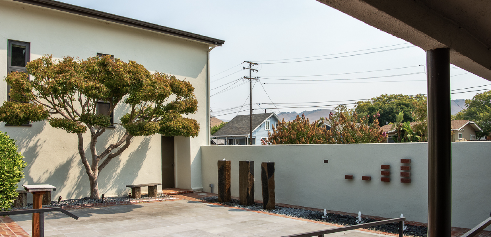
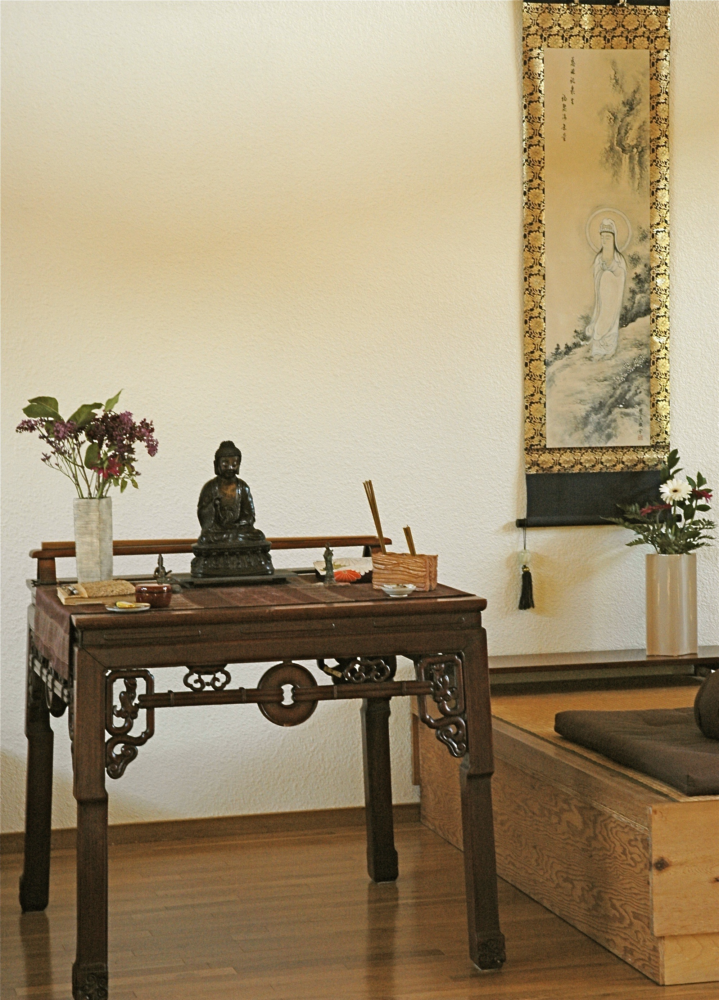
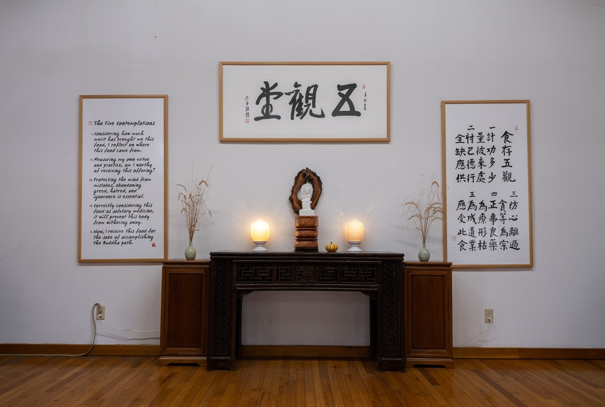
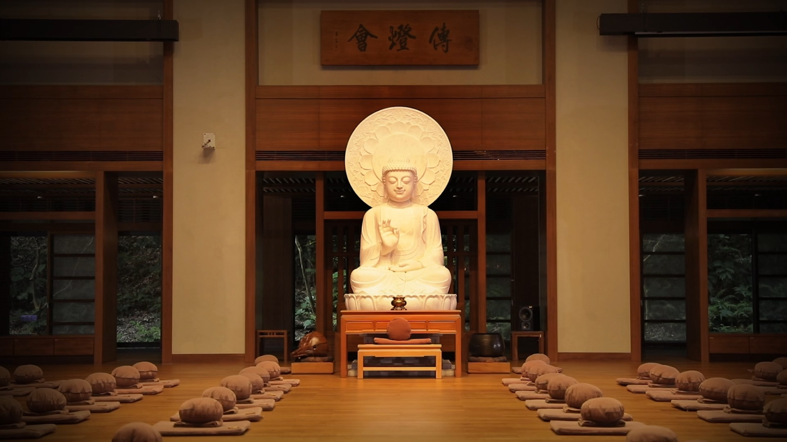
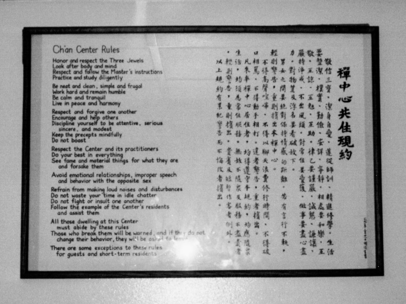
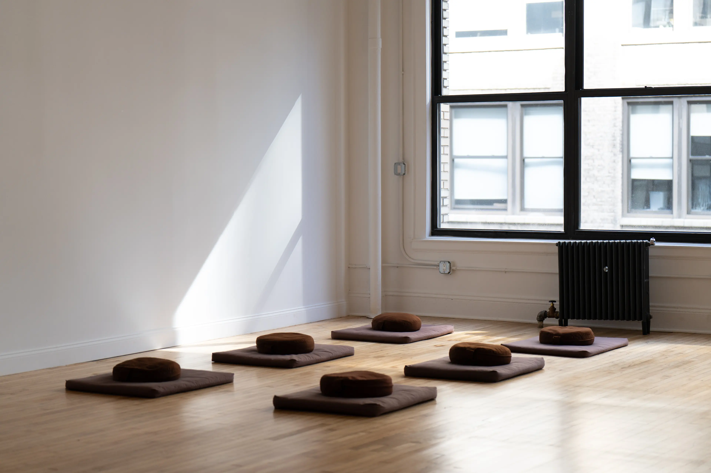
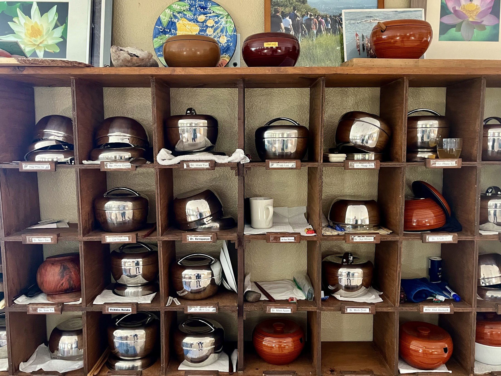
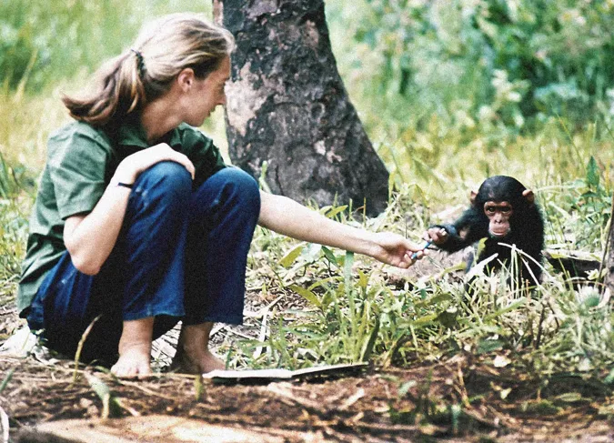

# 觀音道場 Practice Centers

## Dharma Drum Mountain San Francisco Bay Area Center 法鼓山舊金山道場

## Kannon Do Zen Meditation Center 觀音堂

## Dharma Drum Retreat Center 法鼓山象岡道場

## Dharma Drum Mountain 法鼓山總本山

## Dharma Drum Chan Meditation Center 法鼓山東初禪寺

## Dharma Drum Meditation Center 法鼓山曼哈頓道場

## Deer Park Monastery 鹿苑寺

## Jane Goodall Institute

