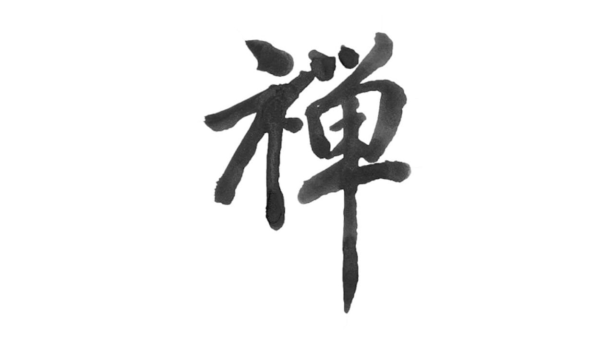
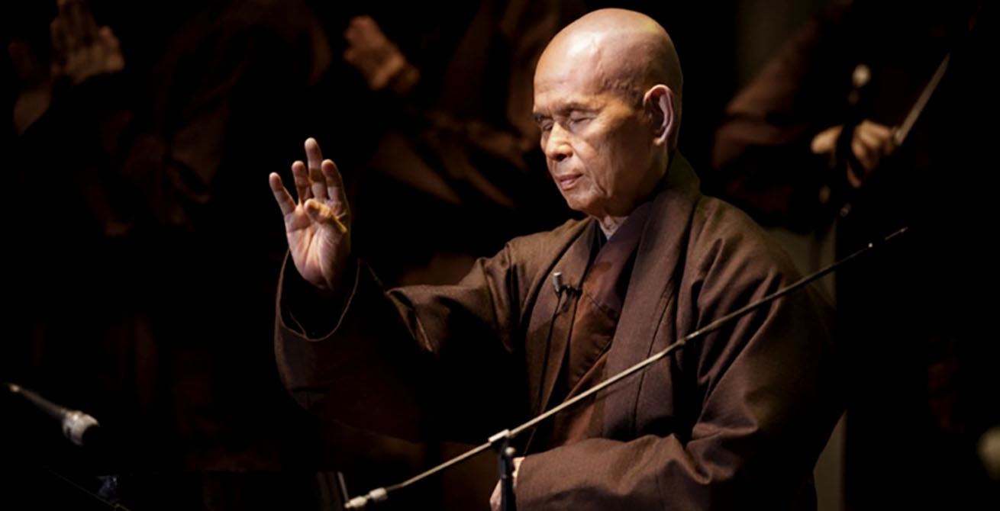
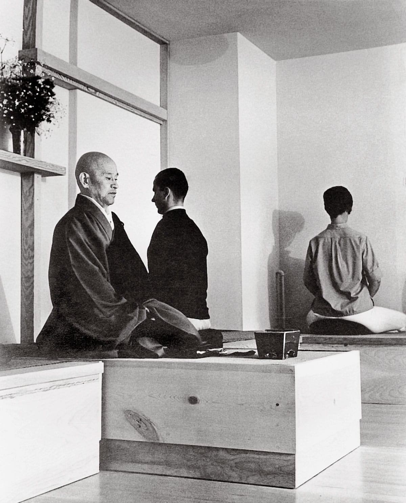

# बुद्धधर्मसङ्घ

佛法僧

*→ 無上甚深微妙法，百千萬劫難遭遇，我今見聞得受持，願解如來真實義。*

## [摩訶般若波羅蜜多心經 Prajnaparamita Heart Sutra](sutras/heart-sutra.md)

觀自在菩薩行深般若波羅蜜多時，照見五蘊皆空，度一切苦厄。

**Gate gate pāragate pārasaṃgate bodhi svāhā**

**無？**

## [金剛般若波羅蜜多經 The Diamond That Cuts Through Illusion](sutras/diamond-sutra.md)

## 大方廣佛華嚴經 Avatamsaka Sutras

夜摩天宮品  
淨行品  
善財童子五十三參

[**普賢十大行願品 *The Ten Great Aspirations of Samantabhadra Bodhisattva***](sutras/samantabhadra-ten-vows.md)

信、願、行

## 圓覺經 Sutra of Perfect Enlightenment

[**圓覺經與禪修基本原則** The Sutra of Complete Enlightenment and the Fundamental Principle of Chan Practice](sutras/complete-enlightenment.md)

知幻即離，不作方便；離幻即覺，亦無漸次

## 楞嚴經

## 六祖壇經 Platform Sutra

[無相頌](chan-texts/%E7%84%A1%E7%9B%B8%E9%A0%8C.md)  
無念為宗，無相為體，無住為本

無念: 前念、今念、後念，念念不被愚迷、憍狂、嫉妒等心念所染；而且念念之中，前念、今念、後念不被前境所縛。心不染著，是為無念。

無相: 心外無法 (法外無心)

無相三皈依  
一體三身自性佛  
清淨法身佛  
千百億化身佛  
圓滿報身佛

參請機緣

無住、無往、亦無來  
無念、無憶、無著

摩訶般若波羅蜜多

心念不起名為坐，內見自性不動名為禪  
外離相為禪，內不亂為定

曹溪本、敦煌本、敦博本

## 阿含經 Agama Sutras

## 大乘起信論 (Awakening Faith of Mahayana)

## [信心銘 Faith in Mind](chan-texts/faith-in-mind.md)

## [顯宗記](chan-texts/%E9%A1%AF%E5%AE%97%E8%A8%98.md)

**神會禪師的悟境**

## 教觀綱宗

**天台心鑰**

信心、行願、知見、方法

## 原人論

**華嚴心銓**

## 禪門鍛鍊説

## 十方三世一切佛。一切菩薩摩訶薩

*→ To know all the Buddhas of the past, present, and future, perceive that Dharmadhatu nature is all created by the mind.*

時間: &lt;過去&gt; → &lt;現在、娑婆&gt; → &lt;未來&gt;  
空間: &lt;東方淨琉璃&gt; ← &lt;現在、娑婆&gt; → &lt;西方極樂&gt;

### &lt;過去&gt;

**燃燈佛**

### &lt;東方淨琉璃&gt;

**藥師佛 (Bhaisajyaguru Buddha)**

脅侍:  
**日光遍照菩薩、月光遍照菩薩**

### &lt;現在、娑婆&gt;

**南無本師釋迦牟尼佛 (人間身)(Shakyamuni Buddha)、悉達多 喬達摩 (Siddhartha Gautama)**

**十大弟子 Ten Disciples**  
舍利弗 Sariputra (智慧)  
須菩提 Subhuti (解空)  
阿難陀 Anada (多聞)  
目犍連 Mahamaudgalyayana (神通)  
大迦葉 Mahakashyapa (頭陀)  
阿那律 Aniruddha (天眼)  
富樓那 Purna (說法)  
迦旃延 Katyayana (論義)  
優波離 Upali (持律)  
羅侯羅 Rahula (密行)

**毘盧遮那佛 (法身)**  
脅侍:  
**文殊師利菩薩 (Manjushri)<u>(大智)</u>、普賢菩薩 (Samantabhadra)(<u>大行)</u>**

脅侍: **觀世音菩薩 (Avalokitasvara)<u>(大悲)</u>、地藏王菩薩 (Ksitigarbharaja)<u>(大願)</u>**

### &lt;西方極樂&gt;

**阿彌陀佛 (Amitabha)**

脅侍:  
**大勢至菩薩 (Mahasthamaprapta)、觀世音菩薩 (Avalokitasvara)**

### &lt;未來&gt;

**彌勒佛 (Maitreya) [彌勒菩薩] (大慈)**  
脅侍:  
**法華林菩薩、大妙相菩薩**

*Like a melody from the heavens, He spontaneously appears. As a wish fulfilling jewel, He satisfies the needs of all sentient beings. Such is the compassion of the Buddha.*

## 傳承

→ 佛教之所以停滯下來，是因為它停止吸收外部的思想與觀念系統。

原始佛教、阿毘達磨 (Abhidharma)、上座部 (Theravada)、般若 (Prajna) 、中觀 (Madhyamaka)、瑜伽師 (Yogācāra)、如來藏 (Tathāgatagarbha)、天台宗、華嚴宗、禪宗

- 龍樹
- 馬鳴
- 菩提達摩
- 鳩摩羅什
- 智者大師
- 玄奘大師
- 三祖僧璨
- **六祖惠能**
- 荷澤神會
- 圭峯宗密
- 大慧宗杲
- 洞山良价
- 宏智正覺
- 永平道元
- 蕅益智旭
- 晦山戒顯
- 太虛大師
- 虛雲老和尚
- 弘一大師
- 印順長老

### 中華禪法鼓宗

**聖嚴法師**

### 梅村傳承

**一行禪師 Thich Nhat Hanh (Thay)**

### 鈴木俊隆傳承

**鈴木俊隆 Shunryū Suzuki**

**Les Kaye**

**Mel Weitsman**

### 根與芽

**珍古德 Jane Goodall**

---

## 目錄

- [修行指引](../skills/practice/bodhisattva-path/README.md)
- [三皈依 The Three Refuges](liturgy/three-refuges.md)
- [四弘誓願 The Four Great Vows](liturgy/four-great-vows.md)
- [摩訶般若波羅蜜多心經 Prajnaparamita Heart Sutra](sutras/heart-sutra.md)
- [**普賢十大行願品 *The Ten Great Aspirations of Samantabhadra Bodhisattva***](sutras/samantabhadra-ten-vows.md)
- [**供養與食存五觀 Meal Time Offering & The Five Contemplations**](liturgy/meal-offering.md)
- [菩薩戒 **Bodhisattva Precepts**](precepts/bodhisattva-precepts.md)
- [**金剛般若波羅蜜多經** The Diamond That Cuts Through Illusion](sutras/diamond-sutra.md)
- [信心銘 Faith in Mind](chan-texts/faith-in-mind.md)
- [**圓覺經與禪修基本原則** The Sutra of Complete Enlightenment and the Fundamental Principle of Chan Practice](sutras/complete-enlightenment.md)
- [**顯宗記**](chan-texts/%E9%A1%AF%E5%AE%97%E8%A8%98.md)
- [坐禪箴](chan-texts/%E5%9D%90%E7%A6%AA%E7%AE%B4.md)
- [無相頌](chan-texts/%E7%84%A1%E7%9B%B8%E9%A0%8C.md)
- [坐禪儀](chan-texts/%E5%9D%90%E7%A6%AA%E5%84%80.md)
- [文獻典籍](library/%E6%96%87%E7%8D%BB%E5%85%B8%E7%B1%8D.md)
- [觀音道場](places/%E8%A7%80%E9%9F%B3%E9%81%93%E5%A0%B4.md)
- [根與芽 Root and Shoots](roots-and-shoots.md)
