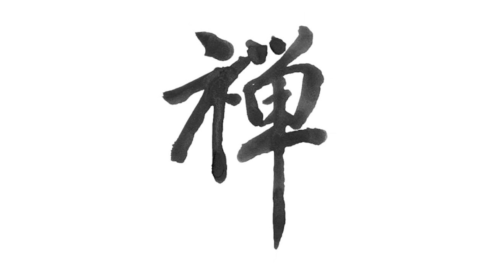
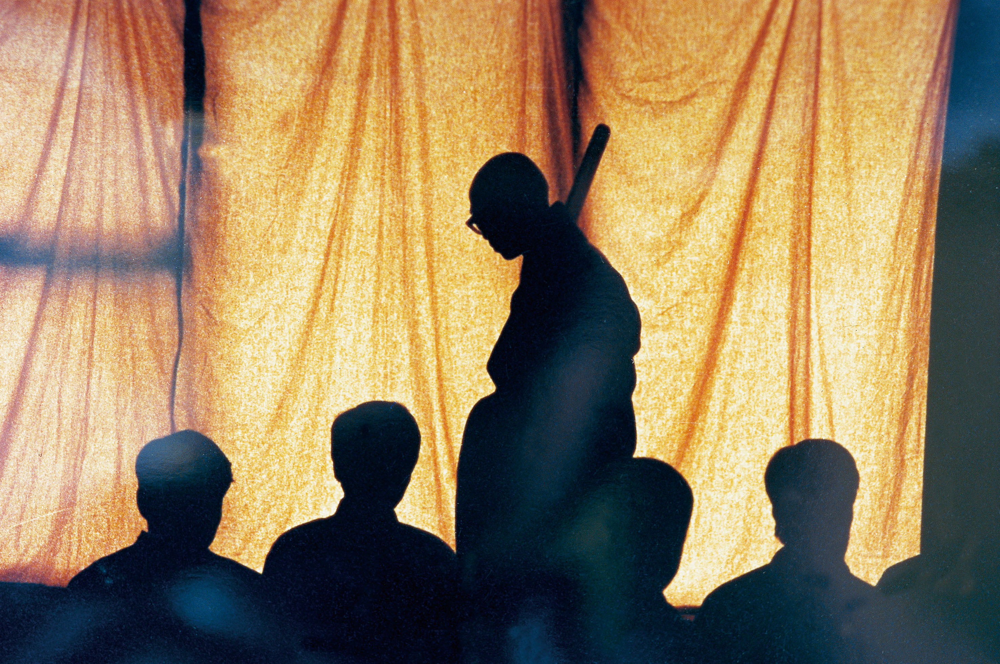
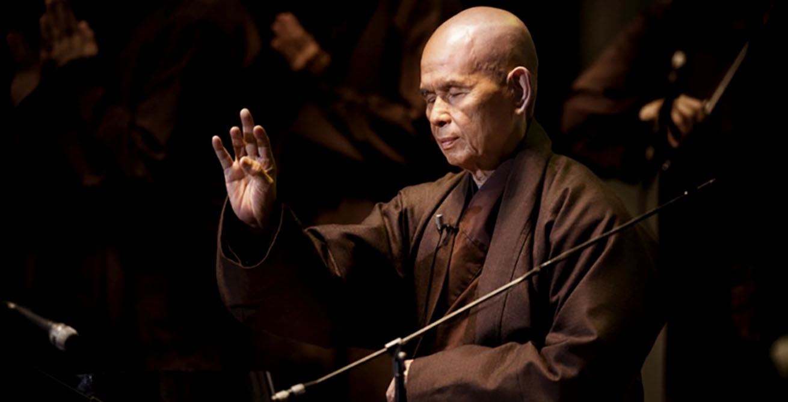
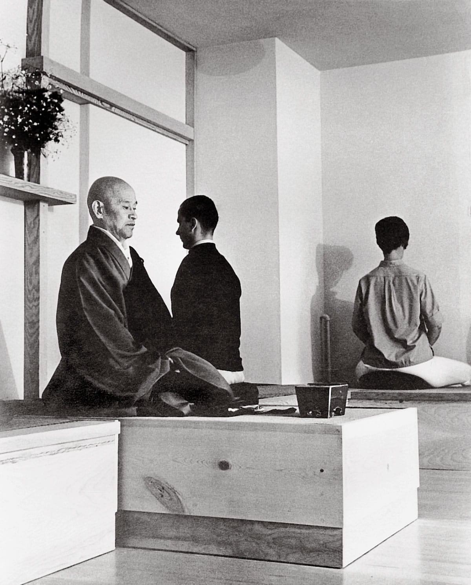

# 傳承 Lineage

## 十方三世一切佛。一切菩薩摩訶薩

*→ To know all the Buddhas of the past, present, and future, perceive that Dharmadhatu nature is all created by the mind.*

時間：〈過去〉 → 〈現在、娑婆〉 → 〈未來〉  
空間：〈東方淨琉璃〉 ← 〈現在、娑婆〉 → 〈西方極樂〉

### 〈過去〉

**燃燈佛**

### 〈東方淨琉璃〉

**藥師佛 (Bhaisajyaguru Buddha)**

脅侍：  
**日光遍照菩薩、月光遍照菩薩**

### 〈現在、娑婆〉

**南無本師釋迦牟尼佛 (Shakyamuni Buddha) (人間身)、悉達多 喬達摩 (Siddhartha Gautama)**

**十大弟子 Ten Disciples**  
舍利弗 Sariputra (智慧)  
須菩提 Subhuti (解空)  
阿難陀 Ananda (多聞)  
目犍連 Mahamaudgalyayana (神通)  
大迦葉 Mahakashyapa (頭陀)  
阿那律 Aniruddha (天眼)  
富樓那 Purna (說法)  
迦旃延 Katyayana (論義)  
優波離 Upali (持律)  
羅睺羅 Rahula (密行)

**毘盧遮那佛 (法身)**  
脅侍：  
**文殊師利菩薩 (Manjushri)<u>(大智)</u>、普賢菩薩 (Samantabhadra)<u>(大行)</u>**

脅侍：  
**觀世音菩薩 (Avalokitasvara)<u>(大悲)</u>、地藏王菩薩 (Ksitigarbharaja)<u>(大願)</u>**

### 〈西方極樂〉

**阿彌陀佛 (Amitabha)**

脅侍：  
**大勢至菩薩 (Mahasthamaprapta)、觀世音菩薩 (Avalokitasvara)**

### 〈未來〉

**彌勒佛 (Maitreya) [彌勒菩薩] (大慈)**  
脅侍：  
**法華林菩薩、大妙相菩薩**

*Like a melody from the heavens, He spontaneously appears. As a wish fulfilling jewel, He satisfies the needs of all sentient beings. Such is the compassion of the Buddha.*

## 傳承

→ 佛教之所以停滯下來，是因為它停止吸收外部的思想與觀念系統。

原始佛教、阿毘達磨 (Abhidharma)、上座部 (Theravada)、般若 (Prajna)、中觀 (Madhyamaka)、瑜伽師 (Yogācāra)、如來藏 (Tathāgatagarbha)、天台宗、華嚴宗、禪宗

- 龍樹
- 馬鳴
- 菩提達摩
- 鳩摩羅什
- 智者大師
- 玄奘大師
- 三祖僧璨
- **六祖惠能**
- 荷澤神會
- 圭峯宗密
- 大慧宗杲
- 洞山良价
- 宏智正覺
- 永平道元
- 蕅益智旭
- 晦山戒顯
- 太虛大師
- 虛雲老和尚
- 弘一大師
- 印順長老

### 中華禪法鼓宗

**聖嚴法師**

### 梅村傳承

**一行禪師 Thich Nhat Hanh (Thay)**

### 鈴木俊隆傳承

**鈴木俊隆 Shunryū Suzuki**

**Les Kaye**

**Mel Weitsman**

### 根與芽

**珍古德 Jane Goodall**
