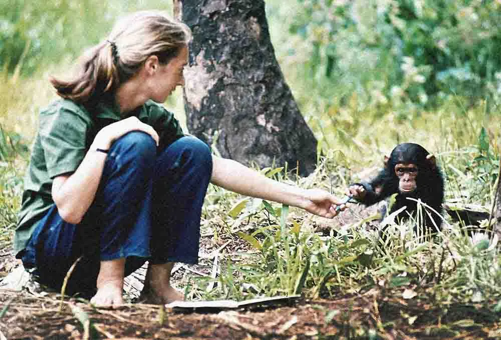

# 根與芽 Root and Shoots

> 根與芽是一種象徵。每一棵大樹都是由種子長成，種子雖然看起來又小又弱，卻擁有很旺盛的能量及生命力。當種子剛開始生長時，會長出小小的根、小小的芽；根雖然非常渺小，可是會努力向下尋求水源，而芽從種子發出來的時候，也同樣會努力掙扎尋找陽光。如果我們對地球造成的各種問題是一道一道城牆。只要世界各地的根與芽一同發揮力量，就能破除這些城牆，破除這些困難，改變整個世界。

**每一個人都很重要，每一個人都有責任，每一個人都可以有所貢獻。**

**從身邊出發，從行動學習**

鼓勵參與者**觀察**生活中的問題、發展解決方案，並在過程中培養同理心、批判性思考與合作能力。無論是校園、社區還是家庭，每一個角落都可以成為行動的起點，讓希望透過每一個孩子的參與而茁壯成長。

- **連結:** 帶領孩子走進自然、走入社區，建立與人、動物及環境之間的情感連結與關懷心。
- **學習:** 提供多元資源與活動，協助孩子認識在地與全球議題，並培養解決問題的能力。
- **行動:** 鼓勵學生自行發想並執行專案，從校園生活到社區實踐，落實環境友善與社會參與。
- **分享:** 透過成果展示、故事分享與交流活動，肯定行動成效，激勵更多人加入改變的行列。

In the place where I am now, I look back over my life. I look back at the world I’ve left behind. What message do I want to leave? I want to make sure that you all understand that each and every one of you has a role to play. You may not know it, you may not find it, but your life matters, and you are here for a reason. And I just hope that reason will become apparent as you live through your life. I want you to know that, whether or not you find that role that you’re supposed to play, your life does matter, and that every single day you live, you make a difference in the world. And you get to choose the difference that you make.

I want you to understand that we are part of the natural world. And even today, when the planet is dark, there still is hope. Don’t lose hope. If you lose hope, you become apathetic and do nothing. And if you want to save what is still beautiful in this world – if you want to save the planet for the future generations, your grandchildren, their grandchildren – then think about the actions you take each day. Because, multiplied a million, a billion times, even small actions will make for great change. I want to – I just hope that you understand that this life on Planet Earth isn’t the end. I believe, and now I know, that there is life beyond death. That consciousness survives.

I can’t tell you, from where I am, secrets that are not mine to share. I can’t tell you what you will find when you leave Planet Earth. But I want you to know that your life on Planet Earth will make some difference in the kind of life you find after you die.

Above all, I want you to think about the fact that we are part – when we’re on Planet Earth – we are part of Mother Nature. We depend on Mother Nature for clean air, for water, for food, for clothing, for everything. And as we destroy one ecosystem after another, as we create worse climate change, worse loss of diversity, we have to do everything in our power to make the world a better place for the children alive today, and for those that will follow.

You have it in your power to make a difference. Don’t give up. There is a future for you. Do your best while you’re still on this beautiful Planet Earth that I look down upon from where I am now.

God bless you all.

**Jane Goodall 1934-2025**
