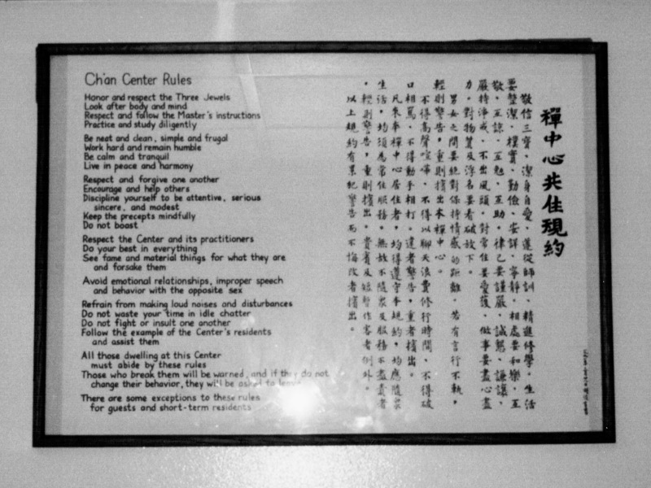

# 定課 Daily Practice

佛法是這麼的好，知道的人是這樣的少，誤解的人又是這樣的多。我要盡量的學習修行，要把我知道的佛法分享給他人。

**禮佛**（[拜佛](method.md#拜佛-prostration)）

**晨坐**（[坐禪](method.md#坐禪)）

**早課**（[心經](../../../content/sutras/heart-sutra.md)、[普賢十大願王](../../../content/sutras/samantabhadra-ten-vows.md)、[四弘誓願](../../../content/liturgy/four-great-vows.md)、[三皈依](../../../content/liturgy/three-refuges.md)、迴向）

**正常、快步[經行](method.md#經行)**

**晚課**（[心經](../../../content/sutras/heart-sutra.md)、[無相頌](../../../content/chan-texts/formless-gatha.md)、[菩薩戒](../../../content/precepts/bodhisattva-precepts.md)）

**OMAD**（藥石、[供養與食存五觀](../../../content/liturgy/meal-offering.md)）

**[八式動禪](method.md#八式動禪)**

**按摩、[瑜珈](method.md#瑜伽)**

記得時時刻刻，處處皆是修行的道場。

