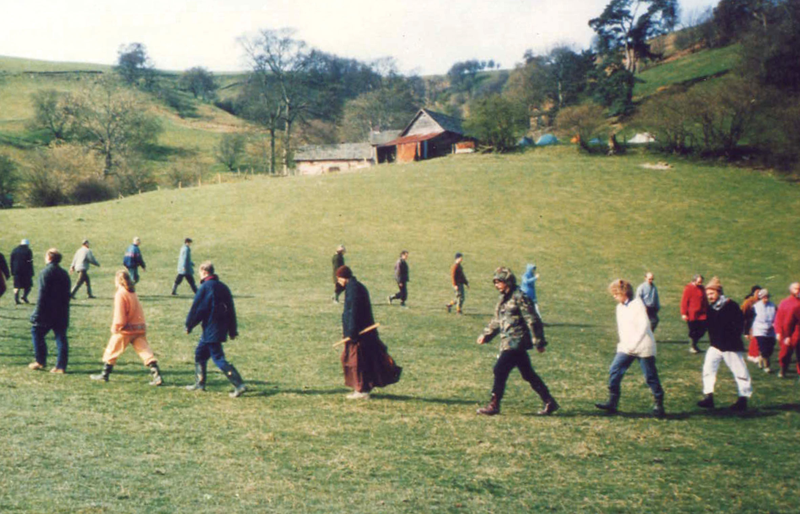

# 方法

> **佛法是這麼的好，知道的人是這樣的少，誤解的人又是這樣的多。我要盡量的學習修行，要把我知道的佛法分享給他人。**

***佛祖之要，教觀而已矣。觀非教不正，教非觀不傳。有教無觀則罔，有觀無教則殆。***

<em>**讓眾生懂得用佛法，就是傳法**，況且**佛法是心法**，**如果佛法已經與你的生命結合，你就真正在弘法傳法了**！</em>

> **身在哪裡，心在那裡。  
> 清楚放鬆，全身放鬆。**

**身心一如、動靜無間**

## 止觀

**繫念在前 (制心)**

- 繫念於能緣的心，而不執取所對的境。
- 識不執取名色。
- 制心一處，無事不辦。

**放鬆、清楚**

止觀與定慧的關係

## 空杯

**Zen Mind, Beginner's Mind**

回到初發心  
赤子之心  
初級禪訓班的空杯、清淨心

## 現在觀

> **明因果、識因緣。**

> **只有方法，沒有妄念；不管妄念，回到方法**

by 聖嚴法師 禪四十九重點提醒

> **面對它，接受它，處理它，放下它**

> **想要、需要、該要、能要。**

想要的太多，需要的不多，該要的才可以要，不能要、不該要的絕對不要。

by 聖嚴法師

> **智慧不是觀念，智慧不是知識，智慧不是經驗，智慧是無我的態度。**

by 聖嚴法師 禪四十九重點提醒

## [無相頌](../../../content/chan-texts/formless-gatha.md)

> **無念為宗，無相為體，無住為本。**

**定、慧、定慧等持**

- 無相者，於相而離相。無念者，於念而無念。無住，念念不住，念念不相續。

疑情 → 於相而離相？  
平等 → 於念而無念？

**禪定**

- 外離相為禪，內不亂為定。

**坐禪 Zazen**

- 心念不起名為坐，內見自性不動名為禪。
- 不著心，不著淨，不是不動。

定慧一體、定慧同時

- 動中修定、境上鍊心
- 用佛的智慧與觀念指導自己

自見本性，無有差別

- 善知識，法無頓漸，人有利鈍。迷即漸勸，悟人頓修。識自本心，是見本性，悟即原無差別，不悟即長劫輪迴。
- 法無頓漸，人有利鈍
- 深種善根，用心經營
- 人身難得，把握修行

無念為宗、無相為體、無住為本

- 善知識，我此法門，從上以來，頓漸皆立無念為宗，無相為體，無住為本。
- 修行的次第：無念、無相、無住
- 著力於有相，以達成無相
- 當下即知無相，才是智慧
- 於念而不念，念念是無常

見性即是見空性

- 斷見與常見都是邪見
- 當下體驗「苦、無常、空、無我」
- 「人無我」、「法無我」，出離一切法
- 覺悟空性，智慧反應

勤修無念、無相、無住

- 「無念、無相、無住」是整體的
- 無念是目標，相是工具 (無相是本質)，無住是原則
- 無念是離念，有念不執著
- 虛空粉碎，大地落沉，法身現前

念念時中，不住一切法

- 是日已過，命亦隨減，如少水魚，斯有何樂？
- 念念不住，連一念都不要住
  - 念念時中，於一切法上無住；一念若住，念念即住，名繫縛。於一切法上，念念不住，即無縛也，以無住為本。
- 活用方法，不死在方法上

見聞覺知，不染萬境

- 離一切相即為無相
- 不染一切境，名為無念
- 真如是念之體，念是真如之用

## 如是我聞

## 以戒為師 Precepts

[菩薩戒 **Bodhisattva Precepts**](../../../content/precepts/bodhisattva-precepts.md)

<u>**止一切惡、修一切善、度一切眾生。**</u>

<u>**無相三皈依戒 → 覺、正、淨**</u>

<u>**生活在離欲的狀態，用戒律來規範。**</u>(Regulate my life.)

<u>**菩薩畏因，眾生畏果。  
覺察動機。**</u>  
<u>**認識自己。**</u>

<u>**身、口、意**</u>

<u>**止持、作持、佛性本來具足的功能**</u>

<u>**根本煩惱：貪、嗔、痴、慢、疑、不正見**</u>

<u>**以無我的觀點看戒律。**</u>

<u>**依照修行的程度，可深可淺的菩薩戒。**</u>

**Precepts → True Freedom**

<u>**如何挑選好老師？ → 對於持戒的態度**</u>

**共識、羯磨**

**我不領眾，我在僧中。**

**和合僧**

- 理和、事和。

**六和敬：**

- 身和同住
- 口和無諍
- 意和同悅
- 戒和同修
- 見和同解
- 利和同均

## 依四念處嚴心而住

## 默擯

<u>**學習接納與誠懇。**</u>

<u>**不要把對方當成敵人，心裡還是要把他當成朋友。**</u>

溝通是雙向的。

暫不往來 →「默」是沉默，「擯」就是驅逐，意思是他不生活在我的範圍裡，我也不生活在他的範圍裡，彼此互不干擾、涉入。

## 體驗呼吸 Breathe (隨息)

人的生命就在呼吸之間

## 懺悔 Repentance

**慚愧 → 懺悔 → 發願 (→ 無相三皈依)**

慚：自知對不起自己  
愧：自知對不起他人

懺，知錯。悔，不再犯。  
懺悔：承認自己的過失，承擔應負的責任。

往昔所造諸惡業，皆由無始貪瞋痴；從身語意之所生，一切我今皆懺悔。

前念、今念、後念、念念不被愚迷染、不被驕誑染、不被嫉妒染，願從前所有惡業愚迷等罪，所有惡業驕誑等罪，所有惡業嫉妒等罪，悉皆懺悔，願一時消滅，永不復起。

念起即覺，覺之即無。

過去心不可得，現在心不可得，未來心不可得。

虛驕、自負 vs 自卑、自賤 (一體兩面)  
一合相者，即是不可說，但凡夫之人，貪著其事。

## 坐禪

**[坐禪儀](../../../content/chan-texts/zazen-gi.md)**

**前方便：**

- 調身
- 調息
- 調眠
- 調食
- 調心

<u>**七支坐法**</u>

**具五緣：**

- 持戒清淨
- 衣食具足
- 閑居靜處
- 息諸緣務
- 近善知識

三時(入靜、止靜、出靜) 調三事(調身、調心、調息)

<u>按摩</u>

## 感恩 Gratitude

**知恩 → 感恩 → 迴向 Transfer Merits**

## 拜佛 Prostration

懺悔、感恩、無相拜佛

## 經行

自然經行、慢步經行、快步經行。

## 八式動禪

## 瑜伽

## 默照

**空盾。**

<u>**知有相是照，不著相是默；知有念是照，離於念是默；念念分明是照，不思前境是默。**</u>

<u>**定是默，慧是照，定慧一體，即是默照同時。**</u>

- 放與鬆。
- 不管過去，不管未來，不管環境裡發生的事，只是用方法。(不斷回到方法)

**基本態度：**

- **發大悲心**
- **放捨諸相**
- **休息萬事**

**基本觀念**

- **正知見：** 因果法和因緣法
- **正行：** 有正確觀念及正確方法的修行生活
- **正精進：** 心情放鬆、身體放鬆，細水長流。

<u>**不觸事而知** (知自微)**，不對緣而照** (照自妙) **。**</u>

<u>**不動是為了精準的動。**</u>

**直觀 Direct Contemplation**

- 觀照事物不帶成見或標籤
- 遇到任何境界不給名字，不加形容，不做比較。

放鬆身心、體驗呼吸、觀全身(關鍵)、觀環境、直觀，空觀。

## 話頭

<u>**什麼是無？  
真實？**</u>

**空劍**。

**佛來佛斬，魔來魔斬**

- 佛：好境界、好現象或好念頭
- 魔：不好的境界、不好的現象，以及不好的念頭

**態度**

- 初發心的態度 (禪者的初心)
- 活在當下，全部身心用話頭
- 提起話頭就是修行
- 心念隨時隨地安住於方法

緊的方式 vs 鬆的方式

**話頭的正確問法**

- 認定一句話頭
- 單提向上 → 觀、照、提
- 身心放下、方法綿密

**生死心。**

**參。**

**嘗試要找出在還未用到話或文字，或符號的描述之前，那是什麼，「探其根源」。**

**參話頭不用想像**

**無心可安就是安心**

**話頭四層次**

- 生死心切念話頭
- 鍥而不捨問話頭
- 結合生命參話頭
- 長養聖胎看話頭

**疑情**

- 疑情 (一種很想知道、追根究底的心情)是一種修行方法，而不是懷疑。
- 疑情不是懷疑，而是堅信一定有個無性的佛性、堅信自己一定能達到明心見性的境界。
- 疑情是和**信心**完全相應的一種方法。

**疑情是參話頭的著力點**

- 製造疑情的條件
  - 參一句話頭
  - 清楚知道自己在參這句話頭
  - 現在雖然不知道話頭最後的功能是什麼，但是堅信一定有功能，而且堅信不斷地問，一定能得到答案 (疑情起於對佛法和自己的信心)
- 疑情起自生死心切
- 疑情即是願力 (疑情是堅決想要知道的懇切心)

**疑情的保持與增強 → 從疑情進入疑團**

**以直心修一行三昧，以一行三昧用話頭**

**以直心用方法**

- 直心是超越主觀與客觀，是不考慮自己，也不考慮大家的想法，事情應該怎麼做就怎麼做。
- 悟道場、耕心地、居淨土
- 直心投入，不起疑心

**以自身修持感動他人**

**入手是念不是參，且必須帶問號**

**無 → 業識未破**

