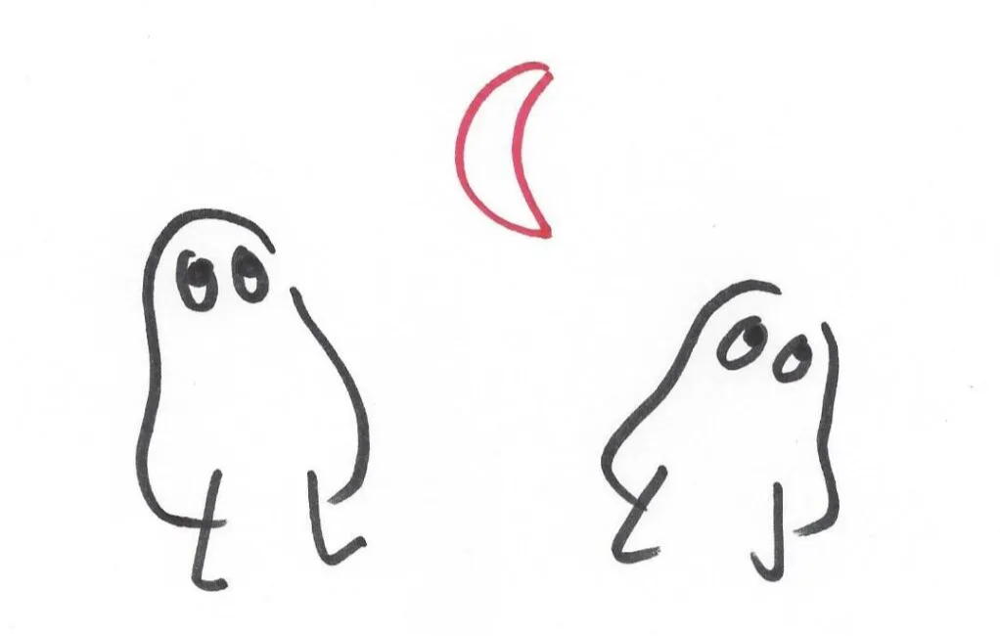
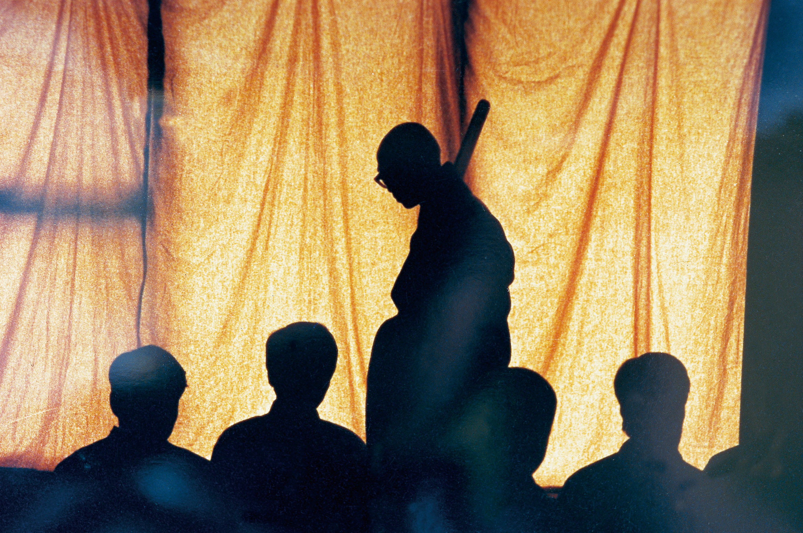
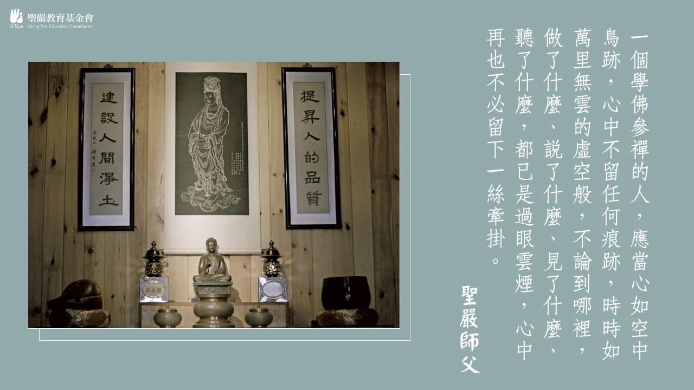
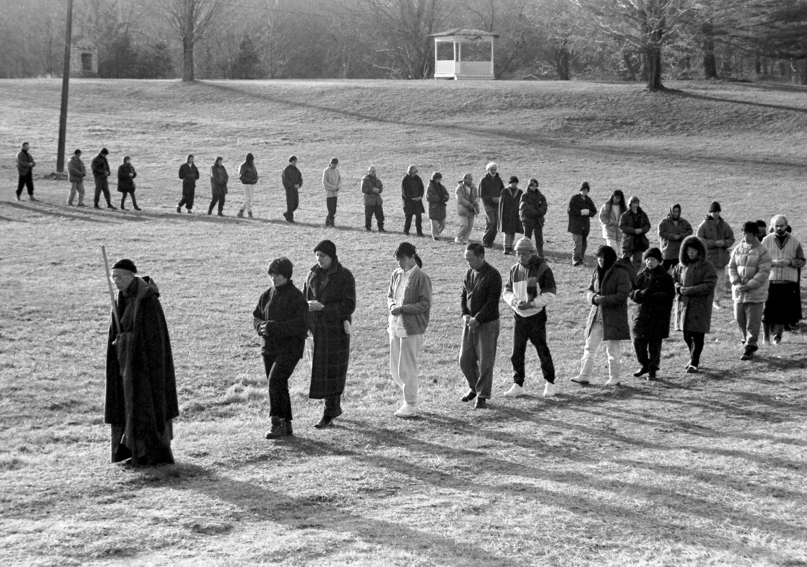

# 知見

## 名相

### 緣起 Dependent Co-Arising

<u>***佛法見地核心***</u>

**信因果、明因緣。**(因、緣、果)(空有不二)  
緣起性空。  
緣起無自性。

因果(時間)

- 因果同時、相應
  - 因果既是前後關係，也是同時發生的現象。
- 「我」存在於因果交替中，因是對果而說，果是從因而起。果從因起易知，因對果說難懂。
- 菩薩畏因，眾生怕果。
- 因該果海，果徹因源。

因緣(空間)

- 因緣有，自性空。
- 「有」是過程，「空」是目的，在達到目的前，不能夠離開「有」的過程，必須在過程中，看目的是空而離過程的有；然後要離有也離空，不落空有，即空即有，才是正見。

**緣生法(果、相)**

- 緣生法無常。
- 緣生法無我。
- 緣生法變異。

**緣起法(因、性、理則)**

- 緣起的法性的我為空。(畢竟空)→ 無法獨一生起法 (佛性不離開現象)<u>**(與梵我不同)**</u>
- 緣起的法性仗緣升起的法為空。 (畢竟空)
- 緣起的法性不空。法性常住，畢竟非空，不生不滅。

→ 修行時要：<u>**離常見、斷見。如實了知。中道。**</u>  
→ 修行時要：留意我的<u>**立足點**</u>是在緣生法上(我尚未出世間)，要空的是我，所以要隨時<u>**反觀自己**</u>。緣所生法還是有，也就是<u>因緣有</u>。因為無常，而<u>自性空</u>。  
→ 證無我難，信法空易。  
→ 禪宗講『無』，只是修行的方便；至於講『有』，才是目的。  
→ 煩惱是否真正減少，待人是否更慈悲？  
→ 信因果與明因緣

<u>**互即互入**</u>  
**Interbeing**

- 法界緣起
- 緣起、一合相、整體、Interbeing (互即互入)、平等觀。
- 過去、現在、未來亦是互即互入。

**一念三千**

- 十世古今始終不離於當念也。
- 一念萬年。

### 苦 Duhkha

煩惱的本質？

### 空 Sunyata / Emptiness

緣起 → 自性空。

<u>**空，空掉孤立的自我 → Interbeing**</u>

<u>以有空義故，一切法得成；若無空義者，一切則不成。</u>

<u>眾因緣生法，我說即是無；亦為是假名，亦是中道義。</u>

### 無常 Anicca / Impermanence

無常 → 常 → 無常 (無住)

### 無我 Anatta

智慧是無我的態度

自我肯定、自我提昇、自我消融

無我是因一切的現象，無論身心世界，均非永恆，妄想執著，為我及我所有，無我是從發現了妄想執著的假我而來，要從妄想的「我執」轉為「無我」的智慧，便是學佛的目的。

自我的消融，是要從自我肯定及自我成長的過程中逐漸完成的。如果連自我是什麼都不知道的人，同他談自我消融是毫無價值的。

時間是過去、現在、未來，無止盡地延續，因此一定要肯定自我存在的價值，要時時把握現在，處處活在當下，盡量避免造罪，努力種植善因，如能得到好的助緣，自然能得好的成果，否則將來的命運，即可能身陷罪惡，無法自拔，就要負擔起後果堪虞的責任了。

想要達到自我消融的目的，必須要學習佛的心量

- 包容心：以廣大無邊的心量，包容一切眾生
  - 包容是靜態地不拒絕任何一個眾生，就是在自我的心中包容一切眾生
- 關懷心：以平等的慈悲，關懷一切眾生
  - 關懷是動態地不捨棄任何一個眾生，就是經常主動去照顧一切眾生。
- 無相心：以無私的智慧，消融自我
  - 無相是超越了能度的自我及被度的眾生，而在包容眾生、關懷眾生，那是慈悲與智慧的總和，廣度眾生而不以為有眾生已度、正度、當度

### 三皈依 Three Refuges

佛 Buddha、法 Dharma、僧 Sangha

**事相上：** 住持三寶、化相三寶。  
**理體上：** 一體三寶、理體三寶。

**無相三皈依戒 (覺、正、淨) (兩足尊、離欲尊、眾中尊)**

- 自心歸依覺，邪迷不生，少欲知足，能離財色，名兩足尊。
- 自心歸依正，念念無邪見，以無邪見故，即無人我貢高貪愛執著，名離欲尊。
- 自心歸依淨，一切塵勞愛慾境界，自性皆不染著，名眾中尊。

**智慧的滿足** ← 沒有執著 (無我的態度)(無智亦無得)(以無所得故)  
**福德的滿足** ← 平等的布施

真實的佛：以戒、定、慧、解脫、解脫知見為身  
正法：觀念、行為合乎佛法的原則(信因果、明因緣)  
淨：身清淨、語清淨、意清淨 (內心離開了財、色、名、食、睡 或 色、聲、香、味、觸)

**向內觀照**

### 三法印 Three Marks of Existence

**諸行無常**  
**諸法無我**  
**涅槃寂靜**

### 三無漏學 Threefold Training

**戒  
定  
慧**

### 心 Citta、覺

**如實(Thusness, Suchness)了知**

- 發阿耨多羅三藐三菩提心者，於一切法，應如是知、如是見、如是信解，不生法相。
- 起信論：因不知一法界故，不覺念起而有無明，遂成眾生。
- 一念不覺生無明。
- 心如工畫師，畫種種五陰。

<u>**心體離念，名之為覺。**</u>  
覺、不覺、始覺、本覺、究竟覺

**活出真實  
無心**

### 見性

見(覺)的本質？  
看見空性？  
圓通

### 佛之三身 Trikaya

法身 Body of Truth (Dharmakaya)

- 常住法身佛 → 本性常住

報身 Body of Enjoyment (Sambhogakaya)

- 常住報身佛 → 不斷常住

化身 Body of Manifestation (Nirmanakaya)

- 常住化身佛 → 相續常住

一體三身自性佛

- 清淨法身佛
- 圓滿報身佛
- 千百億化身佛

### 無

**觀自在菩薩，行深般若波羅蜜多時，照見五蘊皆空，度一切苦厄。**  
絕觀、醒覺  
不是有、不是沒有

### 眾生

不悟即佛是眾生，一念悟時，眾生是佛。  
眾生：眾緣和合生起的現象

### 出離心

### 菩提心 Bodhicitta

菩提 = 覺悟

發心菩提、伏心菩提、明心菩提、出到菩提、無上菩提

成就直心性，具足智慧性，嚴淨世界性，度脫眾生性。(善財四德)

### 信、願、行

### 信心

信心不二，不二信心。

### 分別心

妄心、煩惱心

### 平常心

### 平等心

### 自心

**自心：** 清淨且無量廣大的智慧心、直心、無漏、無我煩惱心

**自性：** 沒有一定形象且清淨不動無障礙的的佛性 (對眾生)、普遍存在的法性 (對一切現象)

自心 (能觀之心、作用)、自性 (體、本體)

### 不二

時間、空間  
生、死  
有、空  
頓、漸  
修行、工作  
僧、俗  
煩惱、菩提  
動、靜  
勝義諦 (Absolute realities)、世俗諦 (Apparent realities)  
空、有  
…

### 體驗 Experience、練習 Practice、方法 Method

主、客、互動  
十八界  
根、塵、識

> **無念為宗，無相為體，無住為本。**

### 六度 Six Paramitas

**布施** Dona (giving)  
**忍辱** Ksanti (patience)  
**持戒** Sila (precepts)  
**精進** Virya (perseverance)  
**禪定** Dhyana (concentration)  
**般若** Prajna (wisdom)

### 四攝

**布施**  
**愛語**  
**利行**  
**同事**

利用四種<u>**攝受**</u>方便之門令眾生產生一種好感和依附之心，當獲得眾生的信任，便可更容易使其親近佛法。

### 體、相、用

### 中道 Middle Way

<u>眾因緣生法，我說即是空，亦為是假名，亦是中道義</u>。

**一心三觀**

- 空(從假入空)
- 假(從空入假)
- 中(中道圓融)

### 四聖諦 Four Noble Truths

苦、集、滅、道

### 十二因緣 Twelve Nidanas

無明 → 行 → **[<u>識 → 名色</u>]** → 六入 → [<u>觸</u>] → <u>**受**</u> → **[<u>愛</u>]** → <u>**[取]**</u> → 有 → 生 → 老死

Ignorance → Formation → <u>**Consciousness**</u> → Name & Form → Sixfold Base → <u>**Contact**</u> → <u>**Feeling**</u> → <u>**Craving**</u> → <u>**Clinging**</u> → Existence / Being → Birth → Aging & Death

### [菩薩戒 Bodhisattva Precepts](../../../content/precepts/bodhisattva-precepts.md)

### 三十七道品 Bodhipakshika

**The four foundation of mindfulness 四念住**

- Mindfulness of body 觀身不淨
- Mindfulness of sensations 觀受是苦
- Mindfulness of mind 觀心無常
- Mindfulness of dharmas 觀法無我

**The four proper exertions 四正勤**

- To keep unwholesome states not yet arisen from arising 未生惡令不生
- To cease unwholesome states already arisen 已生惡令斷滅
- To give rise to wholesome states not yet arisen 未生善令生起
- To continue wholesome states already arisen 已生善令增長

**The four steps to magical powers 四神足**

- Concentration of desire 欲神足
- Concentration of exertion 勤神足
- Concentration of mind 心神足
- Concentration of inquiry 觀神足

**The five roots 五根**

- Faith 信根
- Diligence 進根
- Mindfulness 念根
- Concentration 定根
- Wisdom 慧根

**The five powers 五力**

- Faith 信力
- Diligence 精進力
- Mindfulness 念力
- Concentration 定力
- Wisdom 慧力

**The seven factors of enlightenment 七覺支**

- Mindfulness 念覺支
- Discernment 擇法覺支
- Diligence 精進覺支
- Joy 喜覺支
- Lightness-and-ease 輕安覺支
- Concentration 定覺支
- Equanimity 捨覺支

**The eight noble path 八正道**

- <u>Right View 正見</u>
- <u>Right Intention 正思惟</u> (於色、受、想、行、識當正思惟 → 其<u>無常</u>如實知) (如理思維 = 從根源思維)
- Right Speech 正語
- Right Action 正業
- Right Livelihood 正命
- Right Effort 正精進
- Right Mindfulness 正念
- Right Concentration 正定

### 止觀 Samatha and Vipassana

**定慧等持**  
定是慧的體，慧是定的用。即慧之時定在慧，即定之時慧在定。

**相應、等持**

### 輪迴 Samsara

識為輪迴的主體，並沒有永恆不變的靈魂在輪迴。

### 業力 Karma

### 能所

### 三解脫門

空 → 無相 → 無願

### 五時八教

五時(教材資料庫)

- 通五時、別五時

化儀四教

- 頓、漸、秘密、不定

化法四教

- 圓(**態度**)、別(**行願**)、通(知見)、藏(**方法**)

**佛以一音演說法，眾生隨類各得解。**

### 貪、嗔、痴、慢、疑、不正見

**根本煩惱**

認識自己

妒忌 = 嗔？ 隨喜功德？

慢心

- 通常之慢、過慢、慢過慢、我慢、**增上慢**、卑劣慢、邪慢

### 慈悲、智慧

### 散亂心、集中心、統一心、無心

<u>**修行檢驗標準**</u>

調心四層次

**散亂心：** 剛開始時的心是散亂的、雜亂的，從散亂心用方法，這個方法使得心能夠傾向集中。

**集中心：** 在修行過程中，必定先經過散亂心的掙扎，然後變成集中。

**統一心：** 集中的心繼續不斷，念頭與念頭之間沒有空間的位置

從集中心漸漸妄念愈來愈少，到完全沒有妄念、雜念，只有方法，此時就出現統一心。統一心有三個層次或現象，那就是**身心統一、內外統一 (空間)、前念與後念統一 (時間)**。但是，我們所期待的是無心，並不是這三個統一心，這都是過程。

**外境：** 眼、耳、鼻、舌、身所接觸的客觀環境與人事  
**內境：** 我們內心對這些事物產生的感受、妄想與煩惱。

**無心：** 沒有執著分別、沒有煩惱妄想。(即定即慧，三業一貫相應)

### 漸修頓悟

整體、一合相

### 摩訶般若波羅蜜

### 六妙門

數、隨、止、觀、還、淨

### 動靜

### 僧俗

### 頓漸

## 提醒

> **佛祖之要，教觀而已矣。觀非教不正，教非觀不傳。有教無觀則罔，有觀無教則殆。**

by 蕅益智旭

解行並重、教觀並重。從禪出教，藉教悟宗。

解行並重，活出佛法。  
一門深入，修行實踐。

> **A cloud never dies.**

by Thay

> **老老實實的用方法。**

by 志龍 師兄

> **需要人做、正要人做、沒有人做的事，我來吧！**

by 聖嚴法師

> **道心第一，健康第二，學問第三。**

by 聖嚴法師

> **在家人要想修行，只有靠自己，要嚴格管理自己，訂出一套可行的功課。**

- 決心起早，訂立一個可行的早課。
- 一年至少參加一次禪七 (不要短過七天)。
- 將生活和修行打成一片。在日常生活中實行修行，隨時抓住機會
- 將布施的念頭常常放在心上，留心抓住機會。
- 在家人修行要靠自己，別人幫不了多少忙，所以健康十分重要。身體健康，住世久長，修行、種福、積功德的機會也就增加，非常重要。

by 沈家楨 居士

> **隨時檢討認識自己。**

- 隨時檢討認識自己。認識自己的弱點。
- 不要批評。包括了批評事及批評人。不是說不辨是非，在沒有證入本性或空性之前，應該要辨別是非，應該對是非有所取捨。

by 沈家楨 居士

> **不要以為一定有明天。**

以為一定有明天，等明天再修的觀念，是在家人修行的大忌。

by 沈家楨 居士

> **不要為煩惱所轉。**

煩惱不必怕，它會自生自滅。

煩惱並不可怕，所怕的是為它所轉及由它所引起的業障。怨嗔、灰心、退心都是由煩惱所引起，也即是為煩惱所轉而產生的後果。

by 沈家楨 居士

> **菩薩於法，應無所住而行布施。**

「應無所住」是修慧，「而行布施」是修福。「應無所住而行布施」連起來，就成為不住相的修福修慧，是無相功德。

隨時抓住機會，儘量布施，任何好事，都將功德回向法界一切眾生。

要存久遠心，不要急於求有所得，或求一切順利。

by 沈家楨 居士

> **大鴨游大路，小鴨游小路，不游就沒有路。**

by 聖嚴法師的父親

根與芽

> **道心之中有衣食，衣食之中無道心。**

by 坂本幸男 (其以靈空光謙禪師的法語勉勵聖嚴法師)

> **慈悲沒有敵人，智慧不起煩惱。**

by 聖嚴法師

<u>**修行自我檢驗標準**</u>

> **No mud, no lotus.**

by Thay

**煩惱即菩提**

> **無事忙中老，空裡有哭笑，本來沒有我，生死皆可拋。**

by 聖嚴法師

> **修行要細水長流。**

by 聖嚴法師

> **行事六要領：堅守原則，充分授權，尊重他人，關懷對方，主動溝通，隨時檢討。**

by 聖嚴法師

> **佛説般若波羅蜜，既非般若波羅蜜，是名般若波羅蜜。**

符號、語言、文字的局限性。

> **人生的目的是來受報、還願的，人生的意義和價值，則是在於奉獻，自利利人、成己成人、增長福慧。**

by 聖嚴法師

> **Ananda! That is not your Mind!**

> **Self is absorbed naturally when the Mind rests in it own resonance of self nature.**

Natural Rhythm of Things.

by Gilbert Gutierrez

> In the true teaching of Lord Buddha, Complete Enlightenment is made of incomplete enlightenments. This means that in the heart of your daily mindful actions, thoughts, and speech, Complete Enlightenment is already there, and you should not strive to look for Complete Enlightenment anywhere else.

by Thay

Sitting with the Buddha, Ven. Ananda once said, "This is half of the holy life, lord: admirable friendship, admirable companionship, admirable camaraderie." The Buddha responded, "Don't say that, Ananda! Don't say that! Admirable friendship, admirable companionship, admirable camaraderie is actually the whole of the holy life.”

> **Without a sangha you lose your practice very soon.**

In order to cultivate and strengthen our Sangha, we first need to cultivate and strengthen our own practice. Once we know how to generate joy and happiness; once we know how to handle our suffering; and once we know how to listen deeply and speak lovingly in order to re-establish communication with our brothers and sisters, then we will have great success in Sangha-building. by Thay

> **Enjoy your life!**

That is why we practice zazen. The kind of life you have is not so important. The most important thing is to be able to enjoy your life without being fooled by things.

by Shunryū Suzuki

> **空花佛事，時時要做；水月道場，處處要建。**

by 虛雲老和尚

> **好的不喜歡，壞的不討厭。**

by 果醒法師

> **心中的媽媽不是媽媽。**

by 果醒法師

> **佛性常不動，現象有來去。**

by 果醒法師

> **Put back your chair!**

by 果元法師

> **修福修慧，樂此不疲。**

by 常興法師

> **和光同塵**

by 常興法師

> **修行重要的是不要辜負自己，而不是對不起佛法。**

by 東初老和尚

> **你的所作所為都會帶來影響，而你要決定，想帶來哪一種影響。**

by Jane Goodall

> **I want to make sure that you all understand that each and every one of you has a role to play. You may not know it, you may not find it, but your life matters, and you are here for a reason.**

by Jane Goodall

> **三分師徒，七分道友。**

by 東初老人

> **記得快樂 (**無條件的快樂**)。Happiness is for you to lose.**

by 楊定一

> **莫得少為足**

by 聖嚴法師

向外探求 vs 向內觀照

有漏是指一邊造作善因一邊享福報，不斷地造因得果，生滅不已，稱為有漏功德。

禪修是為身心的健康、精神的昇華、智慧的開發；不要迷戀神祕的經驗，更不是要追求神通，否則會帶來身心的干擾。

> **The core teaching from Suzuki Roshi is not shikantaza but sincerity.**

by Gil Fronsdal

> **以度假的心情、欣賞的態度禪修**

by 常興法師

> **生命依存於這個色身，其短暫無常。記得用生命活出佛法。**

by 果徹法師

隨伴業

> **指授即無，惟論見性，不論禪定解脫。**

> **有道者得，無心者通。**

> **無事忙中老，空裏有哭笑，本來沒有我，生死皆可拋。**

by 聖嚴法師

> **一個學佛參禪的人，應當心如空中鳥跡，心中不留任何痕跡，時時如萬里無雲的虛空般，不論到哪裡，做了什麼，說了什麼，見了什麼，聽了什麼，都已是過眼雲煙，心中再也不必留下一絲牽掛。**

by 聖嚴法師

> **知幻即離，不作方便；離幻即覺，亦無漸次。**

